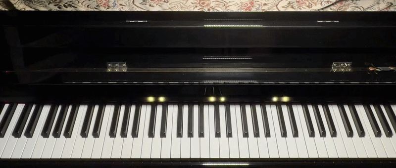
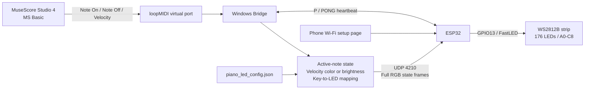
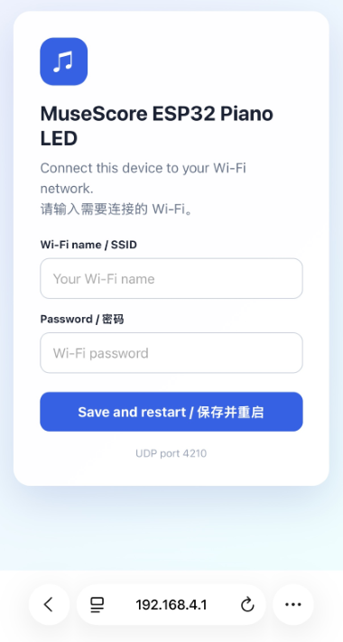
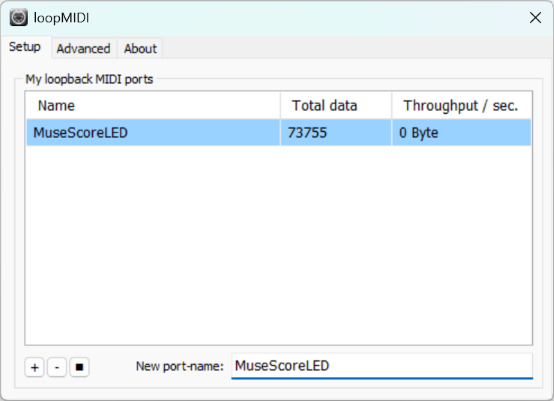
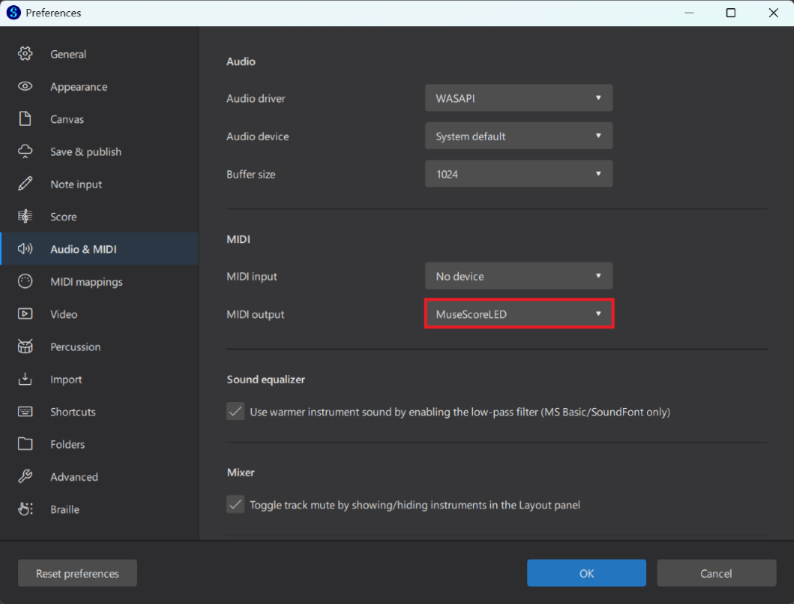
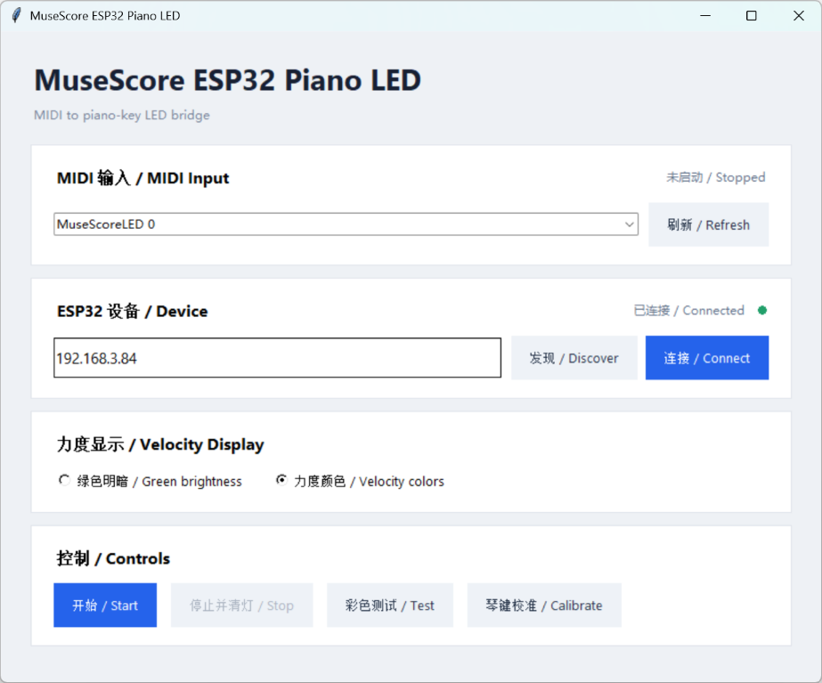
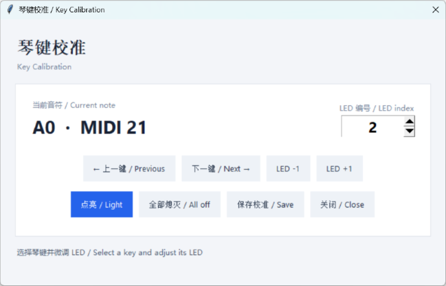

[中文说明](README_ZH.md)
# MuseScore ESP32 Piano LED

Use **MuseScore Studio 4 Desktop**, loopMIDI, the Windows Bridge, and an ESP32 to display notes, chords, and velocity changes on a WS2812B strip above a standard 88-key piano.

<!-- Save the real performance GIF as docs/images/led-performance-demo.gif -->


## Main Features

- Standard A0-C8, 88-key piano range
- Real-time display of notes, chords, trills, and rapid passages
- Full RGB state-frame control for 176 WS2812B LEDs
- Two MIDI velocity display modes:
  - **Green brightness**: a fixed green color with velocity mapped to brightness
  - **Velocity colors**: soft notes in blue, moving through cyan and yellow to orange-red for strong notes
- Automatic ESP32 discovery and manual IP entry
- ESP32 status verification using `P/PONG` heartbeat messages. Automatic stop and disconnected status after repeated heartbeat failures
- Center-out rainbow test animation beginning at C4
- Sustain pedal processing is not included

> The project has been used with MuseScore Studio 4 Desktop. Other versions or applications that emit standard MIDI playback events may work, but they have not been verified. In theory, the same setup should also work on macOS by using the built-in IAC Driver virtual MIDI bus instead of loopMIDI on Windows. The remaining application and ESP32 control flow should be largely the same, but it has not yet been tested on macOS.

## Architecture and Information Flow



### LED Timing

The Bridge combines event-triggered updates with periodic full frames:

1. A MIDI Note On or Note Off immediately wakes the LED frame thread.
2. Full state frames are still transmitted at the configured `led_frame_interval_ms`.
3. The ESP32 clears LEDs that are not listed in the current frame.
4. `min_led_on_ms` is measured from Note On.
5. If a note has already exceeded the minimum display duration, Note Off removes it immediately instead of adding another hold period.

This produces more distinct visual articulation in trills and dense short-note passages.

## Required Hardware

- ESP32 DevKitC or compatible board
- WS2812B strip, 144 LEDs per metre
- More than 1.22 metres of strip, with at least 176 LEDs
- A few spare LEDs are recommended; excess strip may be cut at a marked cut line
- Stable 5 V power supply or power bank
- 330-470 ohm resistor in series with the data line
- Connecting wires
- Optional approximately 1000 uF capacitor across the strip input

### Power Recommendation

At a conservative maximum of approximately 60 mA per WS2812B at full white, ten illuminated LEDs require approximately 0.6 A. Allowing for the ESP32 and margin, use at least **5 V 2 A**, with **5 V 3 A recommended**.

> [!CAUTION]
> **Do not power the full strip from the ESP32 3.3 V pin or through the development board. Use a separate stable 5 V supply. ESP32 GND, strip GND, and the supply negative terminal must share a common ground.**

## Wiring

```text
ESP32 GPIO13 ---- 330-470 ohm ---- WS2812B DIN

5 V supply positive ---------------- WS2812B 5V
5 V supply negative ---------------- WS2812B GND
ESP32 GND --------------------------- 5 V supply negative
```

- Connect to `DIN`, not `DOUT`
- Follow the direction arrows on the strip
- LED0 is expected at the left A0 end
- Firmware uses `GRB` color order by default
- Cut only at marked cut lines

## ESP32 Firmware and Wi-Fi

1. Open `firmware/MuseScore_ESP32_Piano_LED.ino` in Arduino IDE.
2. Install ESP32 board support and FastLED.
3. Select the correct board, serial port, and partition scheme.
4. Upload the firmware.
5. Use a 115200 baud Serial Monitor to view the AP name or IP address.

On first boot, or when saved Wi-Fi cannot be reached, the ESP32 creates:

```text
MuseScoreLED-XXXX
```

Connect a phone to the AP and open:

```text
http://192.168.4.1
```

Enter the Wi-Fi name and password. The ESP32 restarts after saving.



After normal startup, hold BOOT for approximately five seconds to erase saved Wi-Fi information. The ESP32 then restarts in setup mode.

> [!NOTE]
> On some tested boards, the onboard LED does not visibly flash red during the Wi-Fi erase and restart sequence. This does not prevent the erase operation. Confirm success by checking whether the `MuseScoreLED-XXXX` access point reappears.

> [!NOTE]
> Do not hold BOOT during power-up or reset because GPIO0 may select firmware flashing mode.

## ESP32 UDP Protocol

- UDP port: `4210`
- Encoding: ASCII
- RGB range: 0-255

```text
F,<seq>,<led>:<r>:<g>:<b>;...  Full state frame; unlisted LEDs are off
L,<led>,<r>,<g>,<b>            Single LED command for calibration
A                              All off; reply OK,ALL_OFF
B,<0-255>                      FastLED global brightness
P                              Heartbeat request; reply PONG
DISCOVER_MUSESCORE_LED          LAN device discovery
```

Discovery reply:

```text
MUSESCORE_LED,<device_name>,<ip>,4210,176
```

## loopMIDI Setup

Download from Tobias Erichsen's official website:

https://www.tobias-erichsen.de/software/loopmidi.html

1. Install and start loopMIDI.
2. Enter a port name such as `MuseScoreLED` under `New port-name`.
3. Click `+` and keep loopMIDI running.
4. The Windows MIDI backend may expose the port as `MuseScoreLED 0`. Use the exact name shown by the Bridge.

```text
MuseScore MIDI Output -> MuseScoreLED
Bridge MIDI Input     -> MuseScoreLED 0
```



## MuseScore Studio 4 Setup

1. Open Preferences.
2. On the I/O page, set MIDI Output to the loopMIDI port.
3. Select **MS Basic** in the Mixer.
4. Play a simple score and confirm that loopMIDI counters change.

> [!IMPORTANT]
> **Use MS Basic.** Muse Sounds or another advanced sound source may not send playback events to the external MIDI port. loopMIDI then shows no data, the Bridge receives no Note On, Note Off, or Velocity events, and the LEDs remain off.



## Install Dependencies and Run

Python 3 is required. From the project directory run:

```powershell
python -m pip install -r requirements.txt
python main.py
```

## Bridge Application

The current Bridge uses a card-based bilingual interface with separate sections for MIDI, ESP32, velocity display, and controls.



### MIDI Input

- Refresh the MIDI input list
- Select the actual loopMIDI input port
- The selection is saved automatically; there is no separate Save button

### ESP32 Status

- `Discover` searches the local network
- `Connect` sends `P` to the entered or saved IP
- A `PONG` reply changes the status to green and connected
- A successful connection saves the ESP32 IP automatically
- A heartbeat check runs every three seconds
- After three consecutive failures, the Bridge marks the ESP32 disconnected and stops LED output

### Controls

- `Start`: opens the MIDI input and begins LED output
- `Stop`: stops MIDI monitoring and clears the strip
- `Test`: runs the center-out rainbow animation
- `Calibrate`: opens the integrated key calibration dialog

Start, Test, and Calibrate are disabled while the ESP32 is offline.

## MIDI Velocity Display

The main window provides two modes, and the selected mode is saved automatically.

### Green Brightness

```json
"mode": "brightness"
```

All notes remain green. Velocity changes brightness. A larger `gamma` generally makes soft notes darker and increases the visual contrast.

### Velocity Colors

```json
"mode": "color"
```

The continuous color scale is:

```text
Soft: blue
Medium-soft: cyan
Medium: yellow
Strong: orange
Maximum: red-shifted orange
```

The maximum color is not pure red. It retains some green contribution so it remains visually bright on typical WS2812B strips. Notes in a chord may have different colors and brightness levels.

## Rapid Notes and Visual Articulation

Recommended current settings:

```json
"playback": {
  "min_led_on_ms": 10,
  "led_frame_interval_ms": 10,
  "led_protocol": "frame"
}
```

- `min_led_on_ms`: minimum total display time measured from Note On
- `led_frame_interval_ms`: maximum periodic frame interval when no event wake-up occurs
- MIDI events wake the frame thread immediately, so an event does not need to wait for the full 10 ms period
- The 10 ms settings give rapid trills clearer on/off boundaries

If Wi-Fi becomes unstable, increase `led_frame_interval_ms` to 15 or 20. Avoid reducing it excessively because that increases UDP traffic and thread scheduling load.

## Integrated Key Calibration

The calibration control is available only after the ESP32 has replied to `P` with `PONG`.

The dialog provides:

- Current note name, MIDI note, and LED index
- Previous and next key navigation across A0-C8
- LED -1 and LED +1 adjustment
- Light current LED
- All off
- Save mapping to `note_to_led`

Shortcuts:

- Left/Right: previous or next key
- Up/Down: decrease or increase LED index
- Space: light the current LED
- `S`: save
- `A`: all off



Check at least A0, C4, and C8 before correcting individual keys.

## Configuration Reference

The Bridge automatically saves the MIDI input, ESP32 IP, velocity mode, and calibration mapping. Other parameters may be edited manually in `piano_led_config.json`.

### ESP32 and Strip

```json
"esp32_ip": "192.168.1.123",
"udp_port": 4210,
"led_count": 176,
"global_brightness": 80
```

- `esp32_ip`: updated after discovery or a successful connection
- `udp_port`: fixed at 4210 and not editable in the UI
- `led_count`: number of LEDs expected by the firmware and mapping
- `global_brightness`: FastLED output limit, from 0 to 255

### Velocity

```json
"velocity": {
  "enabled": true,
  "mode": "color",
  "min_brightness_ratio": 0.05,
  "gamma": 1.8
}
```

- `enabled`: enables velocity-based output
- `mode`: `brightness` or `color`
- `min_brightness_ratio`: minimum brightness for the weakest notes
- `gamma`: response curve; larger values generally darken soft notes and increase contrast

### Playback and Frame Timing

```json
"playback": {
  "min_led_on_ms": 10,
  "led_frame_interval_ms": 10,
  "led_protocol": "frame"
}
```

Keep 10/10 as the initial setting. If network behavior becomes unstable, increase the frame interval before increasing the minimum LED time.

### Connection Animation

```json
"connect_animation": {
  "trail_length": 5,
  "step_ms": 22
}
```

- `trail_length`: number of LEDs in the moving tail
- `step_ms`: animation step duration

### MIDI and Key Mapping

```json
"midi_input": "MuseScoreLED 0",
"note_to_led": {
  "21": 2,
  "60": 79,
  "108": 174
}
```

- `midi_input`: saved after selection
- `note_to_led`: MIDI-note-to-LED mapping modified by the integrated calibration dialog

> [!CAUTION]
> Back up the JSON file before manual editing. JSON does not allow comments, trailing commas, or missing quotation marks.

## Troubleshooting

### loopMIDI Shows No Data

Confirm that MuseScore uses **MS Basic**.

### ESP32 Shows No Response

Confirm that the PC and ESP32 are on the same LAN and check the IP. Windows Firewall or the router may block UDP discovery or replies.

### Arduino IDE Reports More Than 100% Program Storage

Select:

```text
Tools -> Partition Scheme -> Huge APP (3MB No OTA / 1MB SPIFFS)
```

If unavailable, select a similarly named `No OTA`, `Minimal SPIFFS`, or `3MB APP` partition.

### Rapid Trills Still Appear Continuous

Confirm that both timing settings are 10 ms and that the latest `main.py` includes event wake-up and Note-On-based minimum display timing.

### Velocity Changes Are Hard to See

Try Velocity Colors or increase `velocity.gamma`. If soft notes become too dim, increase `min_brightness_ratio` slightly.

### Test Animation Is Sent but the Strip Remains Off

Check the IP, UDP 4210, GPIO13, DIN/DOUT, strip direction, 5 V supply, and common ground.

### Keys Are Shifted or Misaligned

Open the integrated calibration dialog, check A0, C4, and C8, then adjust individual keys.

### No Red Flash During Wi-Fi Erase

Some boards do not show a visible onboard LED flash. If the ESP32 restarts and the `MuseScoreLED-XXXX` AP reappears, the saved Wi-Fi information has been erased.
