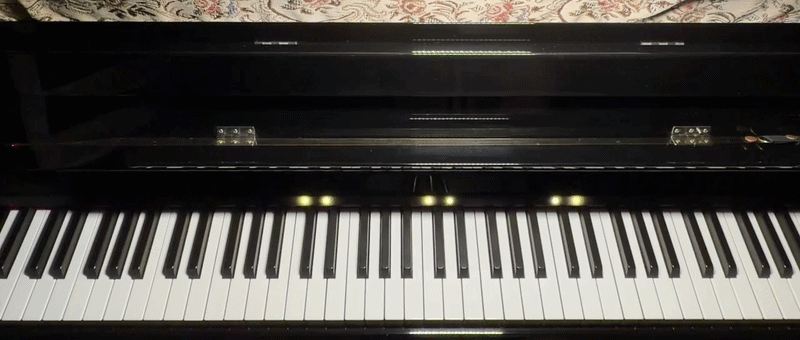
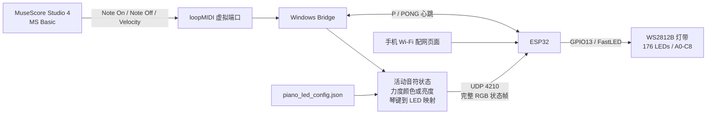
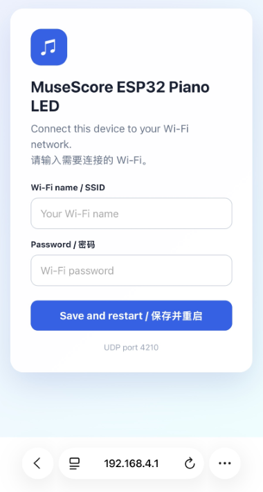
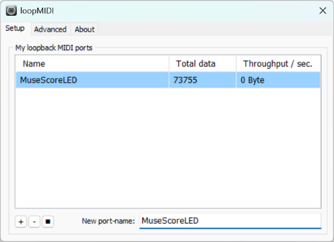
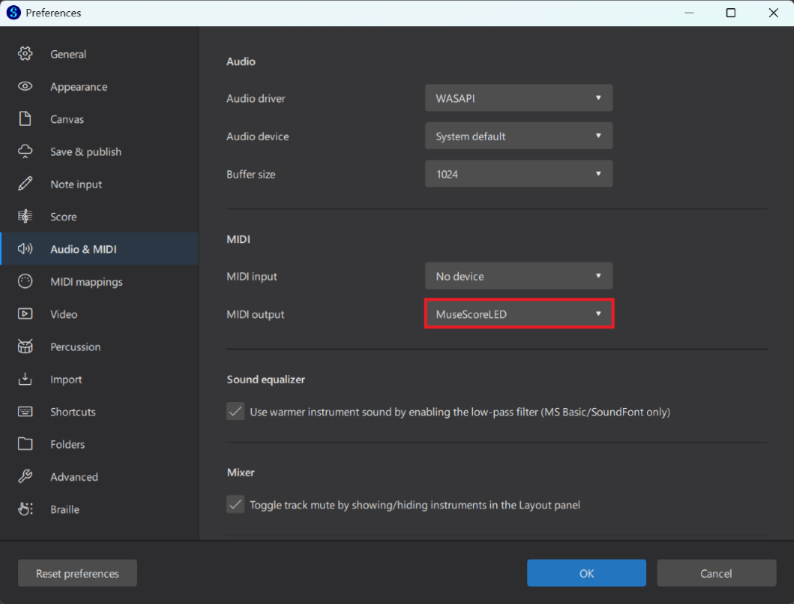
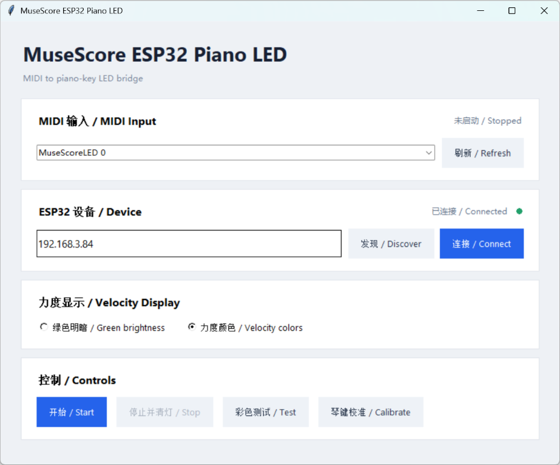
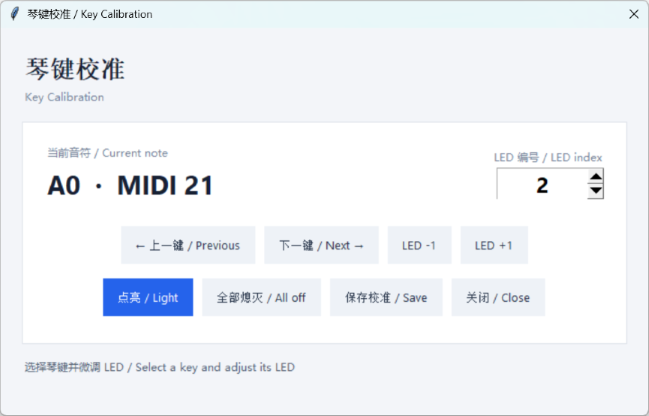

# MuseScore ESP32 钢琴 LED

通过 **MuseScore Studio 4 桌面版**、loopMIDI、Windows Bridge 和 ESP32，在标准 88 键钢琴上方实时显示乐谱播放的音符、和弦与力度变化。

<!-- 将实拍演示 GIF 保存为 docs/images/led-performance-demo.gif -->


## 主要功能

- 支持标准 88 键钢琴范围 A0-C8
- 实时显示单音、和弦和快速连续音
- 使用完整 RGB 状态帧控制 176 颗 WS2812B LED
- 支持两种 MIDI 力度显示模式：
  - **绿色明暗**：颜色保持绿色，以亮度表现强弱
  - **力度颜色**：弱音为蓝色，经青色、黄色过渡到强音的橙红色
- 自动发现 ESP32，也可手动填写 IP
- 使用 `P/PONG` 心跳检查 ESP32 状态，连续多次无响应时，将界面状态更新为断开并停止 LED 输出
- 支持从 C4 向两侧展开的彩色测试动画
- 不处理延音踏板

> 当前项目已在 MuseScore Studio 4 桌面版上使用。其他 MuseScore 版本或能够输出标准 MIDI 播放事件的软件可能兼容，但尚未验证。macOS 理论上也可使用相同方案，只需用系统自带的 IAC Driver 虚拟 MIDI 通道替代 Windows 上的 loopMIDI，后续程序与 ESP32 控制链路基本相同，但目前尚未实测。

## 工作原理与信息流



### LED 时序处理

主程序同时采用事件唤醒和周期性完整帧两种机制：

1. 收到 MIDI Note On 或 Note Off 后，立即通知 LED 帧线程发送新状态。
2. 即使没有新事件，也按 `led_frame_interval_ms` 周期发送完整状态帧。
3. ESP32 会清除当前帧中未列出的 LED，避免灯珠残留。
4. `min_led_on_ms` 表示从 Note On 开始计算的最短总亮灯时间。
5. 如果音符本身已经持续超过最短时间，Note Off 后立即熄灭，不再追加保持时间。

这套处理比单纯使用固定等待循环更适合快速颤音和密集短音。

## 所需硬件

- ESP32 DevKitC 或兼容开发板
- WS2812B 灯带，144 LED/m
- 灯带长度大于 1.22 m，至少保留 176 颗灯珠
- 建议多保留若干灯珠用于安装调整，多余部分可沿灯带剪切线剪掉
- 稳定的 5V 电源或充电宝
- 330-470 Ω 数据串联电阻
- 连接线
- 可选约 1000 µF 电容，并联在灯带 5V 和 GND 输入端

### 供电建议

按每颗 WS2812B 全白最大约 60 mA 保守估算，同时点亮 10 颗约需 0.6 A。计入 ESP32 和余量后，建议至少使用 **5V 2A**，推荐 **5V 3A**。

> [!CAUTION]
> **不要由 ESP32 的 3.3V 引脚或通过开发板为整条灯带供电。灯带应使用独立、稳定的 5V 电源。ESP32 GND、灯带 GND 和电源负极必须共地。**

## 硬件接线

```text
ESP32 GPIO13 ---- 330-470 Ω ---- WS2812B DIN

5V 电源正极 -------------------- WS2812B 5V
5V 电源负极 -------------------- WS2812B GND
ESP32 GND ----------------------- 5V 电源负极（共地）
```

注意：

- 必须连接灯带的 `DIN`，不要连接 `DOUT`
- 灯带箭头应从 ESP32 数据输入端指向后续灯珠
- 默认 LED0 位于钢琴左侧 A0 一端
- 固件默认使用 `GRB` 色序
- 只能沿灯带标注的剪切线剪裁

## ESP32 固件与 Wi-Fi

1. 在 Arduino IDE 中打开 `firmware/MuseScore_ESP32_Piano_LED.ino`。
2. 安装 ESP32 开发板支持和 FastLED。
3. 选择正确的开发板、串口和分区方案。
4. 上传固件。
5. 串口监视器设为 115200，可查看热点名称或 ESP32 IP。

首次启动或已保存的网络无法连接时，ESP32 创建：

```text
MuseScoreLED-XXXX
```

手机连接该热点后，打开：

```text
http://192.168.4.1
```

输入 Wi-Fi 名称和密码，保存后 ESP32 自动重启。



正常启动后，可长按 BOOT 约 5 秒清除已保存的 Wi-Fi 信息，随后 ESP32 重启并重新进入配网模式。

> [!NOTE]
> 实际测试中，清除 Wi-Fi 并重启时，部分开发板的板载 LED 不会出现明显红色闪烁。这不影响 Wi-Fi 擦除和重启功能。请以 ESP32 是否重新出现 `MuseScoreLED-XXXX` 热点作为判断依据。

> [!NOTE]
> 不要在上电或复位过程中一直按住 BOOT，否则 GPIO0 可能让 ESP32 进入烧录模式。应等待正常启动后再长按。

## ESP32 UDP 协议

- UDP 端口：`4210`
- 编码：ASCII
- RGB 范围：0-255

```text
F,<seq>,<led>:<r>:<g>:<b>;...  完整状态帧，未列出的 LED 熄灭
L,<led>,<r>,<g>,<b>            单个 LED，供校准使用
A                              全部熄灭，回复 OK,ALL_OFF
B,<0-255>                      设置 FastLED 全局亮度
P                              心跳请求，回复 PONG
DISCOVER_MUSESCORE_LED          局域网设备发现
```

发现回复：

```text
MUSESCORE_LED,<device_name>,<ip>,4210,176
```

## loopMIDI 设置

从 Tobias Erichsen 官方网站下载：

https://www.tobias-erichsen.de/software/loopmidi.html

1. 安装并启动 loopMIDI。
2. 在 `New port-name` 中输入名称，例如 `MuseScoreLED`。
3. 点击 `+` 创建端口，并保持 loopMIDI 运行。
4. Windows MIDI 后端可能显示为 `MuseScoreLED 0`，请以 Bridge 下拉菜单为准。

```text
MuseScore MIDI Output -> MuseScoreLED
Bridge MIDI Input     -> MuseScoreLED 0
```



## MuseScore Studio 4 设置

1. 打开 Preferences / 首选项。
2. 在 I/O 页面将 MIDI Output 设置为 loopMIDI 端口。
3. 在 Mixer / 混音器中选择 **MS Basic**。
4. 播放简单乐谱，确认 loopMIDI 数据计数发生变化。

> [!IMPORTANT]
> **必须选择 MS Basic。**如果使用 Muse Sounds 或其他高级音源，MuseScore 可能不会向外部 MIDI 端口发送播放事件。此时 loopMIDI 看不到数据，Bridge 收不到 Note On、Note Off 和 Velocity，LED 不会点亮。



## 安装依赖与运行

需要 Python 3。在项目目录执行：

```powershell
python -m pip install -r requirements.txt
python main.py
```

## Bridge 主程序

新版 Bridge 使用卡片式双语界面，将 MIDI、ESP32、力度显示和控制功能分区展示。



### MIDI 输入

- 点击 `刷新 / Refresh` 更新 MIDI 输入端口
- 从下拉列表选择 loopMIDI 实际端口
- 选择变化后自动保存，不再需要单独的 Save 按钮

### ESP32 连接状态

- `发现 / Discover`：在局域网中搜索 ESP32
- `连接 / Connect`：向手动输入或已保存的 IP 发送 `P`
- 收到 `PONG` 后显示绿色连接状态
- 连接成功后自动保存 ESP32 IP
- 运行期间每 3 秒进行一次心跳检查
- 连续 3 次无响应后显示连接中断，并停止 LED 输出

### 控制按钮

- `开始 / Start`：打开 MIDI 输入并开始 LED 输出
- `停止并清灯 / Stop`：停止 MIDI 监听并发送全灭命令
- `彩色测试 / Test`：播放从 C4 向两侧展开的测试动画
- `琴键校准 / Calibrate`：打开内嵌校准弹窗

ESP32 未连接时，开始、彩色测试和琴键校准按钮会保持灰色。

## MIDI 力度显示

主界面提供两种可即时切换的力度模式。切换结果自动写入配置文件。

### 绿色明暗

```json
"mode": "brightness"
```

所有音符保持绿色，力度通过亮度表现。`gamma` 越大，弱音与强音之间的亮度差异越明显。

### 力度颜色

```json
"mode": "color"
```

力度按连续色彩映射：

```text
弱音：蓝色
中弱：青色
中等：黄色
强音：橙色
最强：偏红的橙红色
```

最强端未使用纯红色，而是保留一定绿色分量，使 WS2812B 上的视觉亮度更明显。和弦中的每个音符可显示不同颜色和亮度。

## 快速音与 LED 颗粒感

建议当前配置：

```json
"playback": {
  "min_led_on_ms": 10,
  "led_frame_interval_ms": 10,
  "led_protocol": "frame"
}
```

- `min_led_on_ms`：从 Note On 开始计算的最短总显示时间
- `led_frame_interval_ms`：无新 MIDI 事件时，完整状态帧的最大周期
- MIDI 事件会立即唤醒帧线程，因此实际响应不必等待完整的 10 ms 周期
- 10 ms 设置可增强快速颤音的明灭边界和颗粒感

如果网络环境不稳定，可将 `led_frame_interval_ms` 调回 15 或 20。不要盲目设得过低，以免增加 UDP 和线程调度负担。

## 内嵌琴键校准

打开条件：

- ESP32 已通过 `P/PONG` 验证在线
- 未连接时校准按钮置灰

功能：

- 显示当前音名、MIDI 编号和 LED 编号
- 上一键、下一键切换 A0-C8
- 使用 LED -1 和 LED +1 微调位置
- 点亮当前 LED
- 全部熄灭
- 保存校准结果到 `note_to_led`

快捷键：

- 左/右：上一键、下一键
- 上/下：LED 编号减一、加一
- 空格：点亮当前 LED
- `S`：保存
- `A`：全部熄灭



建议至少检查 A0、C4 和 C8，再逐键修正偏差。

## 配置文件参考

主程序会自动保存 MIDI 端口、ESP32 IP、力度模式和校准映射。其他参数可手动编辑 `piano_led_config.json`。

### ESP32 与灯带

```json
"esp32_ip": "192.168.1.123",
"udp_port": 4210,
"led_count": 176,
"global_brightness": 80
```

- `esp32_ip`：发现或连接成功后自动更新
- `udp_port`：协议固定为 4210，主界面不提供修改
- `led_count`：固件和实际灯带使用的灯珠数量
- `global_brightness`：FastLED 全局亮度上限，范围 0-255

### 力度

```json
"velocity": {
  "enabled": true,
  "mode": "color",
  "min_brightness_ratio": 0.05,
  "gamma": 1.8
}
```

- `enabled`：是否根据 Velocity 计算显示效果
- `mode`：`brightness` 或 `color`
- `min_brightness_ratio`：最弱音的最低亮度比例
- `gamma`：力度曲线。数值越大，弱音更暗，强弱差异通常更明显

### 播放与刷新

```json
"playback": {
  "min_led_on_ms": 10,
  "led_frame_interval_ms": 10,
  "led_protocol": "frame"
}
```

建议先保留 10/10。如出现网络抖动，可优先把帧间隔提高到 15 或 20，而不是增加最短亮灯时间。

### 连接动画

```json
"connect_animation": {
  "trail_length": 5,
  "step_ms": 22
}
```

- `trail_length`：测试动画拖尾长度
- `step_ms`：动画每一步的时间

### MIDI 与琴键映射

```json
"midi_input": "MuseScoreLED 0",
"note_to_led": {
  "21": 2,
  "60": 79,
  "108": 174
}
```

- `midi_input`：选择端口后自动保存
- `note_to_led`：MIDI 音符到 LED 编号的映射，由内嵌校准弹窗修改

> [!CAUTION]
> 编辑 JSON 前建议保留备份。JSON 不允许注释、尾随逗号或缺失引号。

## Troubleshooting

### loopMIDI 数据为零

首先确认 MuseScore 使用 **MS Basic**。

### ESP32 显示未响应

确认电脑和 ESP32 在同一局域网，并检查 IP。Windows 防火墙或路由器可能阻止 UDP 广播或回复。

### ESP32 编译超过程序空间

Arduino IDE 选择：

```text
Tools -> Partition Scheme -> Huge APP (3MB No OTA / 1MB SPIFFS)
```

如无此选项，可选择类似 `No OTA`、`Minimal SPIFFS` 或 `3MB APP` 的分区。

### 快速颤音仍然连成一片

确认配置中的 `min_led_on_ms` 和 `led_frame_interval_ms` 均为 10，并使用包含事件唤醒及 Note On 起算逻辑的最新版 `main.py`。

### 力度变化不明显

尝试力度颜色模式，或提高 `velocity.gamma`。如果弱音太暗，则适当提高 `min_brightness_ratio`。

### 彩色测试发送但灯带不亮

检查 ESP32 IP、UDP 4210、GPIO13、DIN/DOUT、灯带方向、5V 供电和共地。

### 键位整体偏移或个别键不准

打开内嵌校准弹窗，先检查 A0、C4、C8，再逐键调整。

### 清除 Wi-Fi 时没有红灯闪烁

部分开发板实测没有明显闪烁。只要长按 BOOT 后设备重启并重新出现 `MuseScoreLED-XXXX` 热点，即可判断 Wi-Fi 信息已经清除。
